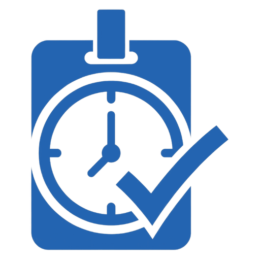

<div dir="rtl">

<p align="center"></p>

# رویدادیار (RoydadYar)

سامانه‌ی **روز اجرای رویداد**: پذیرش شرکت‌کننده‌ها، ثبت‌نام در محل، تحویل وعده‌های پذیرایی، و دیدن شمارش زنده. چند اپ و یک افزونه‌ی وردپرس است که با هم کار می‌کنند. این صفحه را برای کسی نوشته‌ایم که هیچ‌چیز درباره‌ی سامانه نمی‌داند.

ساخته‌ی **تیم راهکارهای نرم‌افزاری نگاه جدید (NewVisionteam)** · [newvisionteam.ir](https://newvisionteam.ir)

## فهرست

1. [این سامانه چه کاری می‌کند؟](#۱-این-سامانه-چه-کاری-میکند)
2. [اجزای سامانه و دانلود](#۲-اجزای-سامانه-و-دانلود)
3. [چه کسی کدام را لازم دارد؟](#۳-چه-کسی-کدام-را-لازم-دارد)
4. [راه‌اندازی از صفر، گام به گام (برای برگزارکننده)](#۴-راهاندازی-از-صفر-گام-به-گام-برای-برگزارکننده)
5. [راهنمای اپ مدیریت](#۵-راهنمای-اپ-مدیریت)
6. [راهنمای اپ نیروها (روز اجرا)](#۶-راهنمای-اپ-نیروها-روز-اجرا)
7. [اپ نیروها روی ویندوز: بارکدخوان و میانبرها](#۷-اپ-نیروها-روی-ویندوز-بارکدخوان-و-میانبرها)
8. [کارت چاپی و QR](#۸-کارت-چاپی-و-qr)
9. [صفحه‌ی عمومی `/c/<token>`](#۹-صفحهی-عمومی-ctoken)
10. [صفحه‌ی ثبت‌نام آنلاین و پرداخت](#۱۰-صفحهی-ثبتنام-آنلاین-و-پرداخت)
11. [بدون اینترنت چه می‌شود؟](#۱۱-بدون-اینترنت-چه-میشود)
12. [مشکل‌یابی](#۱۲-مشکلیابی)
13. [حریم خصوصی و امنیت](#۱۳-حریم-خصوصی-و-امنیت)
14. [برای توسعه‌دهنده](#۱۴-برای-توسعهدهنده)
15. [وضعیت فعلی و محدودیت‌ها](#۱۵-وضعیت-فعلی-و-محدودیتها)

---

## ۱. این سامانه چه کاری می‌کند؟

یک کنفرانس را فرض کنید با ۲۸۰ شرکت‌کننده. روز اجرا:

- جلوی میز پذیرش صف هست. نیرو نام فرد را جستجو می‌کند (یا کارتش را اسکن می‌کند)، «تیک پذیرش» می‌زند و کارت چاپی‌اش را می‌دهد.
- ظهر صف ناهار هست. نیرو کارت را اسکن می‌کند و گوشی در یک نگاه می‌گوید «مجاز، تحویل شود» یا «قبلاً گرفته» یا «این وعده شامل او نیست».
- کسی بی‌خبر آمده. نیرو او را در محل ثبت‌نام می‌کند و یک کارت رزرو به او می‌دهد.
- برگزارکننده در حال راه رفتن بین سالن‌هاست و می‌خواهد بداند چند نفر آمده‌اند و کدام نیرو بی‌خبر است.

همه‌ی این کارها **بدون اینترنت هم کار می‌کند**. گوشی‌ها کار را نگه می‌دارند و با اولین اتصال می‌فرستند. هر کار در یک «دفتر رخدادها» روی سرور ثبت می‌شود، پس دو نیرو که همزمان کار می‌کنند یکدیگر را خراب نمی‌کنند و هیچ اتفاقی گم نمی‌شود.

چند قاعده‌ی ثابت در همه‌ی اپ‌ها:

- **رنگ فقط معنا دارد:** سبز یعنی «بده»، قرمز یعنی «نده»، کهربایی یعنی «دقت کن»، خاکستری یعنی «ناشناخته». هیچ وضعیتی فقط با رنگ نمایش داده نمی‌شود؛ آیکن و نوشته هم دارد.
- **آفلاین خطا نیست.** نشانگر بالای صفحه خاکستری می‌شود، نه قرمز. قرمز فقط وقتی است که دسترسی یک گوشی باطل شده باشد.
- **اسکن شرط نیست.** هر کاری با جستجوی نام هم شدنی است. اگر رویدادی کارت ندارد یا بارکدخوان نیست، اپ گیر نمی‌کند.

## ۲. اجزای سامانه و دانلود

آخرین نسخه‌ها در بخش [Releases](../../releases/latest) هست.

| جزء | برای چه کسی | چیست | فایل |
| --- | --- | --- | --- |
| **رویدادیار نیروها** · اندروید | نیروهای میز پذیرش و پذیرایی | کار روز اجرا با دوربین گوشی | `RoydadYar-Staff-…-android-arm64.apk` |
| **رویدادیار نیروها** · ویندوز | لپ‌تاپ روی میز | همان کار، با صفحه‌کلید و بارکدخوان USB | `RoydadYar-Staff-…-windows.zip` |
| **رویدادیار مدیریت** · ویندوز | برگزارکننده، پیش از رویداد | ساخت رویداد، ورود اکسل، کارت، نیروها، گزارش | `RoydadYar-Admin-…-windows.zip` |
| **رویدادیار مدیریت** · اندروید | برگزارکننده روز اجرا | گزارش زنده، جستجوی افراد، دستگاه‌ها | `RoydadYar-Admin-…-android-arm64.apk` |
| **افزونه‌ی وردپرس** | مدیر سایت (یک بار) | سرور سامانه + صفحه‌ی عمومی QR + داشبورد | `RoydadYar-WordPress-plugin-….zip` |

فایل‌های `armv7` فقط برای گوشی‌های اندرویدی خیلی قدیمی‌اند. اگر `arm64` نصب نشد، `armv7` را امتحان کنید.

نام هر فایل نسخه و شماره‌ی ساخت را دارد، مثلاً `RoydadYar-Admin-0.3.0-b57-android-arm64.apk`. همان در «درباره»ی اپ دیده می‌شود («نسخه‌ی 0.3.0 (ساخت 57)») و نسخه‌ی افزونه در وردپرس `0.3.0.57` است. شماره‌ی ساخت همیشه بالا می‌رود، پس نسخه‌ی تازه‌تر روی قبلی نصب می‌شود و می‌شود فهمید کدام ساخت روی کدام دستگاه است.

### نصب اپ اندروید

1. فایل `.apk` را روی گوشی بگیرید و باز کنید.
2. اگر اندروید پرسید، «نصب از این منبع» را برای همان مرورگر یا فایل‌منیجر روشن کنید.
3. نسخه‌ی تازه روی نسخه‌ی قبلی نصب می‌شود و اطلاعات گوشی پاک نمی‌شود.

### نصب اپ ویندوز

1. فایل `.zip` را در یک پوشه باز کنید. **کل پوشه** لازم است، نه فقط فایل `.exe`.
2. `RoydadYarStaff.exe` (نیروها) یا `RoydadYarAdmin.exe` (مدیریت) را اجرا کنید.
3. اپ‌ها امضای دیجیتال ندارند، پس ویندوز ممکن است «SmartScreen» نشان دهد. «More info» و بعد «Run anyway» را بزنید.

### نصب افزونه‌ی وردپرس

1. «افزونه‌ها ← افزودن ← بارگذاری افزونه»، و فایل zip افزونه را بدهید.
2. اگر نسخه‌ی قبلی هست، «جایگزینی نسخه‌ی فعلی» را بزنید. داده‌ها می‌مانند.
3. افزونه را فعال کنید و یک بار «تنظیمات ← پیوندهای یکتا ← ذخیره» را بزنید.
4. منوی تازه‌ی **رویدادیار** در پیشخوان می‌آید. جزئیات در [`wp-plugin/README.md`](wp-plugin/README.md).

## ۳. چه کسی کدام را لازم دارد؟

| نقش شما | چه می‌کنید | چه نصب می‌کنید |
| --- | --- | --- |
| **مدیر سایت** | افزونه را نصب می‌کند و کلید API می‌سازد | افزونه‌ی وردپرس |
| **برگزارکننده** | رویداد را آماده می‌کند، کارت‌ها را چاپ می‌دهد، روز اجرا نظارت می‌کند | مدیریت ویندوز (آماده‌سازی)، و اگر خواست مدیریت اندروید (روز اجرا) |
| **نیروی پذیرش یا پذیرایی** | شرکت‌کننده‌ها را می‌پذیرد یا وعده تحویل می‌دهد | نیروها (اندروید یا ویندوز) |
| **گرافیست** | کارت را طراحی می‌کند | هیچ‌چیز؛ فقط [راهنمای کارت](#۸-کارت-چاپی-و-qr) |
| **شرکت‌کننده** | کارت می‌گیرد؛ اگر QR را با دوربین بخواند، صفحه‌ی خودش را می‌بیند | هیچ‌چیز |

## ۴. راه‌اندازی از صفر، گام به گام (برای برگزارکننده)

ترتیب مهم است؛ اپ مدیریت هم مراحل را به همین ترتیب در ناوبری کناری می‌گذارد و کنار هر مرحله می‌نویسد آماده است یا نه.

**گام ۰: افزونه.** مدیر سایت افزونه را نصب می‌کند (بالا). بعد در «رویدادیار ← تنظیمات» دکمه‌ی **ساخت کلید** را می‌زند و کلید را همان لحظه کپی می‌کند؛ دوباره نمایش داده نمی‌شود. کلید و آدرس سایت را به برگزارکننده می‌دهد.

**گام ۱: اتصال و رویداد.** اپ مدیریت را باز کنید. آدرس سایت و کلید API را بنویسید و «اتصال» را بزنید. بعد رویداد را بسازید: کد لاتین (مثلاً `conf1405`)، نام، تاریخ شروع و پایان (**میلادی**، مثل `2026-11-11`)، و آدرس پایه‌ی لینک QR. آدرس پایه را خالی بگذارید تا آدرس همین سایت باشد.

**گام ۲: پیکربندی.** این‌ها را تعریف کنید و «ذخیره روی سرور» را بزنید:

- **شناسایی در روز اجرا:** کارت QR با اسکن، کارت بدون اسکن، یا بدون کارت (توضیح در [بخش ۸](#۸-کارت-چاپی-و-qr)).
- **QR برای دیگران چه کند:** صفحه‌ی فرد، انتقال به یک آدرس، یا کارت ویزیت.
- **انواع ثبت‌نام:** مثلاً «ارائه‌دهنده» و «شرکت‌کننده».
- **نقش‌ها:** مثلاً «سخنران»، «داور»، «نیروی اجرایی».
- **وعده‌های پذیرایی:** هر وعده یک روز (میلادی) دارد و مشخص می‌کنید چه نوع ثبت‌نام یا نقشی حق آن را دارد. فرد اگر نوعش **یا** نقشش در فهرست باشد مجاز است.
- **برنامه‌ی کنفرانس:** جلسه‌ها با روز، ساعت شروع و پایان، عنوان، سالن و نوع. روی صفحه‌ی عمومی QR نمایش داده می‌شود. از اکسل هم وارد می‌شود.
- اگر پیکربندی خالی است، دکمه‌ی «پر کن» مقدارهای پیشنهادی را می‌گذارد.

**گام ۳: نیروها.** برای هر نیرو نام و PIN (۴ تا ۸ رقم، برای هر نفر متفاوت) بگذارید و سه اجازه را تعیین کنید: پذیرش، پذیرایی، مدیر. «مدیر» یعنی می‌تواند پذیرش اشتباه را لغو کند. دکمه‌ی «PIN تصادفی» برای کسانی که PIN ندارند می‌سازد. **PINها را قبل از ذخیره یادداشت کنید؛ بعد از ذخیره دیگر نمایش داده نمی‌شوند.** اگر فراموش شد، PIN تازه بدهید.

**گام ۴: شرکت‌کننده‌ها (ورود از اکسل).** چهار کار:

1. فایل `.xlsx` یا `.csv` را انتخاب کنید (فایل `.xls` قدیمی را در اکسل با فرمت `.xlsx` ذخیره کنید).
2. اپ ستون‌ها را حدس می‌زند. «کدام ستون چیست؟» را بررسی و اصلاح کنید.
3. نوع ثبت‌نام همه‌ی ردیف‌های این فایل را انتخاب کنید و «پیش‌نمایش» را بزنید. هشدارها با شماره‌ی ردیف فهرست می‌شوند.
4. «ارسال … نفر به سرور» را بزنید.

**هر کس در اکسل هست وارد می‌شود**، چون یعنی ثبت‌نام کرده و روز اجرا باید پذیرش شود. ردیف مشکل‌دار رد نمی‌شود، فقط هشدار می‌گیرد:

| ردیف | چه می‌شود |
| --- | --- |
| نام یا نام خانوادگی خالی | با هر چه هست وارد می‌شود و «ناقص» علامت می‌خورد |
| هیچ نامی ندارد | با ایمیل یا موبایلش نشان داده می‌شود: «بی‌نام (ایمیل)». اگر آن‌ها هم نیست «بی‌نام (ردیف ۱۲)»؛ این نام روی کارت چاپ نمی‌شود |
| همان نام و همان ایمیل/موبایل دو بار | یک نفر است که دو بار ثبت‌نام کرده؛ یک بار وارد می‌شود تا دو کارت چاپ نشود |
| ایمیل یا موبایل مشترک با نام دیگر (مثلاً ایمیل شرکت) | دو نفر جدا وارد می‌شوند |

افراد ناقص در پایین همین صفحه، در «افراد ناقص»، با دکمه‌ی «ویرایش» فهرست می‌شوند تا پیش از چاپ کارت تکمیلشان کنید (در اپ مدیریت اندروید: تب «افراد»). روز اجرا، نیرو هنگام پذیرش هشدار می‌بیند و می‌تواند همان‌جا تکمیل کند. ورود دوباره‌ی اکسل اطلاعاتی را که تکمیل شده پاک نمی‌کند، چون خانه‌ی خالی اکسل چیزی را پاک نمی‌کند. کارت‌ها به ترتیب نام خانوادگی چیده می‌شوند، کسی که نام خانوادگی ندارد با نامش، و بی‌نام‌ها آخر.

هر فایل یک نوع ثبت‌نام دارد. اگر دو گروه با دو نوع دارید، دو فایل جدا وارد کنید. ورود دوباره‌ی همان فایل کسی را تکراری نمی‌کند و کارت چاپ‌شده‌اش را عوض نمی‌کند؛ شناسه‌ی هر نفر از ایمیل، یا اگر نبود موبایل، یا اگر نبود نام ساخته می‌شود.

ستون‌هایی که اپ می‌شناسد (با نام فارسی یا انگلیسی):

| ستون | نمونه عنوان | الزامی؟ |
| --- | --- | --- |
| عنوان | عنوان، لقب، title | نه |
| نام | نام، first name | بله |
| نام خانوادگی | نام خانوادگی، فامیلی، last name | بله (یا «نام کامل» در یک ستون) |
| ایمیل | ایمیل، email | نه |
| موبایل | موبایل، تلفن همراه | نه |
| سازمان | سازمان، دانشگاه، affiliation | نه |
| کشور | کشور، country | نه |
| نوع ارائه | نوع ارائه (پوستر/شفاهی) | نه |
| نقش | نقش، role | نه (باید در پیکربندی تعریف شده باشد) |
| اشتراک اطلاعات تماس | بله / خیر | نه |
| صفحه‌ی شخصی | لینک | نه |

**گام ۵: کارت‌ها.** (اگر رویداد «بدون کارت» است این مرحله نیست.)

1. **نوع کارت:** بار اول سه پرسش می‌آید: یک‌رو یا دورو، QR دارد یا نه، و QR روی کدام سمت ([جزئیات پایین](#نوع-کارت-یکرو-یا-دورو-qr-یا-نه)).
2. **کارت‌های رزرو** بسازید: برای کسانی که بی‌خبر می‌آیند. پیشنهاد اپ حدود ۱۰٪ تعداد ثبت‌نامی‌هاست.
3. **طرح و متن‌ها:** طرح گرافیست را برای رو (و در کارت دورو پشت) انتخاب کنید، جای QR را تنظیم کنید و در «متن‌های کارت» نام، نقش و هر متن دیگری را بچینید؛ متن می‌تواند ثابت، از فیلدهای سامانه یا از ستون‌های اکسل باشد ([جزئیات پایین](#متنهای-کارت)). «پیش‌نمایش» ناحیه‌ی امن را نشان می‌دهد و «آزمون نام بلند» طولانی‌ترین نام لیست را امتحان می‌کند.
4. **بررسی پیش از چاپ** را بخوانید. اگر چیزی قرمز است (QR کوچک، متن بیرون ناحیه‌ی امن یا روی QR، تصویر کم‌کیفیت) اول درستش کنید.
5. در «چیدمان برای چاپخانه» انتخاب کنید چاپخانه کارت‌ها را چطور می‌خواهد ([جزئیات پایین](#چیدمان-روی-بوم-چاپ)). «ساخت PDF کارت‌ها» را بزنید و فایل را به چاپخانه بدهید. هم‌زمان **آدرس پایه قفل می‌شود** (اگر کارت QR دارد)، چون QRهای چاپ‌شده به آن وابسته‌اند.
6. «PDF لیست پشتیبان کاغذی» را هم بگیرید و چاپ کنید؛ اگر همه‌چیز خراب شد، با کاغذ هم می‌شود پذیرش کرد.

**گام ۶: آزمایش.** یک گوشی نیرو را با PIN وارد کنید و پیش از روز اجرا یک پذیرش و یک تحویل وعده امتحان کنید. بعد در «گزارش زنده» ببینید عددها عوض شد.

**گام ۷: روز اجرا.** هر نیرو اپ نیروها را باز می‌کند و با کد رویداد و PIN وارد می‌شود (بخش بعد).

## ۵. راهنمای اپ مدیریت

### نسخه‌ی ویندوز

ناوبری کناری شش مرحله دارد: اتصال و رویداد، پیکربندی، نیروها، شرکت‌کننده‌ها، کارت‌ها، گزارش زنده. زیر هر مرحله یک خط وضعیت واقعی هست («۲۸۰ نفر»، «۲ نیرو، ۱ بدون PIN»). مرحله‌ای که نیاز به توجه دارد کهربایی است. میانبرها: `Ctrl+1` تا `Ctrl+6`. پایین ناوبری روی «رویدادیار ۰٫۲» بزنید تا کارت «درباره» باز شود.

**گزارش زنده** این‌ها را نشان می‌دهد و هر ۳۰ ثانیه می‌تواند خودکار تازه شود:

- پذیرش‌شده از کل، ثبت‌نام در محل، کارت رزرو آزاد، و موارد مشکوک.
- پذیرش بر اساس نوع ثبت‌نام، و برای هر وعده: چند نفر حق دارند، چند نفر گرفتند، چند بار تکراری، چند بار بدون حق.
- **موارد مشکوک:** پذیرش تکراری، وعده‌ی تکراری، وعده‌ی بدون حق، موبایل تکراری در ثبت‌نام در محل، کارت رزرو اشتباه.
- **دستگاه‌ها:** هر گوشی یا رایانه با آخرین همگام‌سازی. بیش از ۱۰ دقیقه بی‌خبر = احتمالاً آفلاین و کارهایش هنوز نرسیده. با «باطل کن» دسترسی همان دستگاه بسته می‌شود.

### نسخه‌ی اندروید

روی گوشی (عرض کمتر از ۱۰۲۴ پیکسل) چهار تب پایین هست:

| تب | چه می‌کند |
| --- | --- |
| **امروز** | همان گزارش زنده، هر ۳۰ ثانیه تازه می‌شود |
| **افراد** | جستجوی هر نفر و تاریخچه‌اش (کی پذیرش شد، چه وعده‌ای گرفت)؛ برای جواب‌دادن به «من ناهار نگرفتم ولی می‌گوید گرفته‌ای». «لغو پذیرش» هم اینجاست |
| **نیروها** | نیروها و دستگاه‌ها |
| **آماده‌سازی** | همان مراحل نسخه‌ی ویندوز، و «درباره و پشتیبانی» |

چند نکته‌ی نسخه‌ی گوشی:

- اپ با **اثر انگشت یا رمز صفحه‌ی گوشی** باز می‌شود، و بعد از ۵ دقیقه در پس‌زمینه دوباره قفل می‌شود. اگر گوشی قفل صفحه ندارد، اپ باز می‌شود ولی هشدار می‌دهد.
- **برای هر گوشی یک کلید جدا** بسازید («رویدادیار ← تنظیمات ← کلیدهای گوشی مدیر» در وردپرس). اگر گوشی گم شد، فقط همان کلید را باطل کنید.
- «کارت‌ها» روی گوشی هم همه‌ی کارها را دارد: انتخاب تصویر طرح، پیش‌نمایش، بررسی پیش از چاپ، جابه‌جایی نام و QR با دکمه‌های − و +، چیدمان بوم، و ساخت PDF کارت‌ها، کارت‌های رزرو و لیست پشتیبان. ساخت PDF همه‌ی کارت‌ها روی گوشی کمی طول می‌کشد. تصویر طرح روی هر دستگاه جدا نگه داشته می‌شود، پس روی گوشی هم یک بار طرح را انتخاب کنید.
- PDFها با «اشتراک‌گذاری» سیستم به تلگرام یا چاپگر می‌روند.

## ۶. راهنمای اپ نیروها (روز اجرا)

> **ظاهر تازه‌ی اندروید (از نسخه‌ی ۰٫۴٫۰).** اپ نیروها روی اندروید طراحی تازه دارد: سربرگ رنگی، ناوبری شناور پایین و شیت‌های پایین‌صفحه. روی ویندوز تا کامل‌شدن طراحی همان ظاهر قبلی می‌ماند. کارها همان است که پایین آمده؛ تفاوت‌های اندروید:
>
> - **برگرداندن ۸ ثانیه‌ای:** بعد از «تیک پذیرش»، دکمه‌ی «اشتباه زدم؟ برگردان» ۸ ثانیه می‌ماند و برای همه‌ی نیروها هست (بعد از آن فقط مدیر می‌تواند لغو کند).
> - **انتخاب وعده:** نام وعده در سربرگ پذیرایی را بزنید؛ وعده‌های امروز با ساعت شروع می‌آیند و وعده‌ای که ساعتش رسیده «الان» است و خودکار انتخاب می‌شود. اگر وعده‌ی روز دیگری روی گوشی مانده باشد، اپ هشدار می‌دهد. ساعت شروع اختیاری است و در اپ مدیریت کنار هر وعده نوشته می‌شود.
> - **تحویل با مجوز شفاهی:** وقتی نتیجه «این وعده شامل او نیست» است، دکمه‌ی «تحویل با مجوز شفاهی مدیر» می‌پرسد چه کسی اجازه داد. تحویل ثبت می‌شود و در گزارش زنده‌ی مدیر، در «موارد مشکوک» با نام اجازه‌دهنده و در ستون «بدون حق» آن وعده می‌آید.
> - **کارهایی که سرور نپذیرفت:** در تب وضعیت هر کدام دو دکمه دارد: «دیدم، پاک کن» یا **«خبر به مدیر»** با یک توضیح کوتاه؛ متن در «موارد مشکوک» گزارش مدیر («خبر از نیرو») دیده می‌شود.
> - **خروج امن:** اگر کار ارسال‌نشده هست، شیت خروج می‌گوید چه کارهایی (مثلاً «۲ پذیرش و ۱ تحویل ناهار») و اول «برگرد و همگام‌سازی کن» را پیشنهاد می‌دهد.
> - **دسترسی باطل شد:** فقط PIN دوباره خواسته می‌شود و کارهای ارسال‌نشده روی گوشی می‌مانند.

### ورود

اپ را باز کنید. سه چیز بنویسید:

| فیلد | چه بنویسید |
| --- | --- |
| **کد رویداد** | همان که برگزارکننده داده، مثل `conf1405` |
| **PIN** | PIN خودتان، از برگزارکننده |
| **نام این گوشی** | مثلاً «پذیرش ۱»؛ چیپ‌های پیشنهادی هم هست |

«ورود و دریافت لیست» را بزنید. **ورود اول اینترنت می‌خواهد**؛ کل لیست روی گوشی ذخیره می‌شود. بعد از آن بدون اینترنت هم کار می‌کند. «تنظیمات پیشرفته» آدرس سایت است و معمولاً دست نمی‌خورد. اگر ۱۰ بار پشت‌سرهم PIN اشتباه بزنید، ۱۰ دقیقه قفل می‌شوید.

زیر صفحه اپ سه تب دارد؛ هر نیرو فقط تب‌هایی را می‌بیند که اجازه‌اش را دارد.

### بالای صفحه: نشانگر همگام‌سازی

یک قرص کوچک همیشه بالا هست:

| نوشته | یعنی |
| --- | --- |
| «ارسال شد، ۱۰:۴۲» | همه‌چیز به سرور رسیده |
| «۱۲ در صف» | ۱۲ کار هنوز نرفته؛ با اینترنت خودکار می‌رود |
| «آفلاین، ۱۲ در صف» | اینترنت نیست. **این خطا نیست؛** اپ کار می‌کند و کارها روی گوشی امن است |
| «در حال ارسال…» | الان دارد می‌فرستد |
| «دسترسی باطل شد» (قرمز) | مدیر این گوشی را باطل کرده؛ دوباره وارد شوید |

لمس آن، همگام‌سازی فوری می‌کند و نتیجه را در یک پیام کوتاه می‌گوید.

### تب پذیرش

۱. بالای صفحه نام، نام خانوادگی یا موبایل را بنویسید (با هر حرف نتیجه می‌آید). اگر رویداد کارت دارد، **شماره‌ی کارت** هم جستجو می‌شود. دکمه‌ی کنار آن کارت را اسکن می‌کند (فقط اگر رویداد اسکن دارد).
۲. روی نام فرد بزنید. هر ردیف یک **حرف دسته** دارد: حرف اول نام خانوادگی (اگر نام خانوادگی ندارد، حرف اول نام؛ بی‌نام‌ها «؟»). کارت‌های چاپی به ترتیب الفبایی نام خانوادگی چیده شده‌اند، پس این حرف می‌گوید دستتان را سمت کدام دسته ببرید.
۳. دکمه‌ی سبز **«تیک پذیرش»** را بزنید.
۴. صفحه می‌گوید «پذیرش شد. کارت را از دسته‌ی «ر» بدهید» و **شماره‌ی کارت** را درشت نشان می‌دهد. کارت را بدهید و **«نفر بعدی»** را بزنید؛ جستجو پاک می‌شود و برای نفر بعدی آماده است.

اگر **اطلاعات فرد ناقص** باشد (در ثبت‌نام نام یا نام خانوادگی را ننوشته)، کادر کهربایی «اطلاعات ناقص» می‌گوید چه چیزی خالی است و اینکه اشکال از اپ نیست. پذیرش مثل همیشه انجام می‌شود. با **«تکمیل اطلاعات»** از خودش بپرسید و خانه‌های خالی را پر کنید (فقط خانه‌های خالی؛ چیزی که هست عوض نمی‌شود). بدون اینترنت هم ثبت می‌شود و با همگام‌سازی به سرور و گوشی‌های دیگر می‌رسد. در تاریخچه‌ی آن فرد در اپ مدیریت هم دیده می‌شود چه نیرویی چه چیزی را تکمیل کرد. حرف دسته عوض نمی‌شود، چون کارت با نام قبلی چیده شده.

اگر ایمیل یا موبایل فرد با کس دیگری یکی باشد، کادر آبی می‌گوید با چه کسی، تا آدم اشتباه پذیرش نشود.

اگر فرد **قبلاً پذیرش شده**، با رنگ کهربایی می‌گوید کی و توسط کدام نیرو. کارت گم‌شده دوباره صادر نمی‌شود. نیروی «مدیر» دکمه‌ی «لغو پذیرش» هم می‌بیند (با پرسش تأیید).

اگر نام در لیست نیست، گزینه‌ی **«پیدا نشد؟ ثبت‌نام در محل»** پایین فهرست هست. وقتی جستجو خالی است، ۵ پذیرش آخر همین گوشی دیده می‌شود.

### ثبت‌نام در محل

برای کسی که در لیست نیست:

1. نام و نام خانوادگی را بنویسید (الزامی)؛ موبایل و ایمیل اختیاری‌اند. اگر موبایل تکراری باشد، اپ می‌پرسد «شاید همین فرد باشد؟».
2. نوع ثبت‌نام را انتخاب کنید.
3. یک **کارت رزرو** بدهید: شماره‌ی روی کارت را بنویسید (`R5001` یا `5001` هر دو درست است)، یا کارت را اسکن کنید.
4. «ثبت، پذیرش و تحویل کارت» را بزنید. فرد هم ثبت می‌شود هم پذیرش.

اگر رویداد «بدون کارت» است، مرحله‌ی کارت نیست و دکمه «ثبت و پذیرش» است. خطاها زیر همان فیلد نوشته می‌شوند.

**کارت رزرو تمام شد؟** وقتی اپ هیچ کارت رزرو آزادی نشان نمی‌دهد، به جای خانه‌ی کارت می‌گوید «کارت رزرو تمام شده» و فرد **بدون کارت** ثبت و پذیرش می‌شود؛ پذیرایی‌اش با جستجوی نام انجام می‌شود. اگر بعداً کارت رزرو تازه چاپ شد (اپ مدیریت ← کارت‌ها ← ساخت کارت رزرو، و در گوشی «وضعیت» ← گرفتن دوباره‌ی لیست)، در صفحه‌ی همان فرد «وصل‌کردن کارت رزرو» را بزنید و شماره را بنویسید یا اسکن کنید؛ آفلاین هم ثبت می‌شود. در گزارش زنده «ثبت‌نام در محل» تعداد بدون کارت را جدا می‌گوید و هر کدام در «موارد مشکوک» با «بدون کارت» می‌آید تا بدانید کارت رزرو بیشتری لازم است.

### تب پذیرایی

1. بالای صفحه چیپ‌های وعده هست و **وعده‌ی امروز خودکار انتخاب می‌شود**. نام وعده در نوار بالا هم تکرار می‌شود. اگر وعده‌ی روز دیگری را بزنید، اپ می‌پرسد «مطمئنید؟».
2. کارت را مقابل دوربین بگیرید. نتیجه روی نیمه‌ی پایین صفحه با رنگ درشت می‌آید و ۴ ثانیه می‌ماند. گوشی هم می‌لرزد: **یک لرزش = مجاز، دو لرزش = رد.**

| رنگ و عنوان | یعنی | کار شما |
| --- | --- | --- |
| **سبز روشن** «مجاز — تحویل شود» | حق دارد و هنوز نگرفته؛ ثبت شد | غذا را بدهید |
| **قرمز تیره** «قبلاً گرفته» | با ساعت قبلی | ندهید |
| **قرمز تیره** «این وعده شامل او نیست» | نوع ثبت‌نامش حق این وعده را ندارد | ندهید |
| **قرمز تیره** «کارت نامعتبر» | کارت در لیست نیست یا رزرو است و به کسی وصل نشده | به میز پذیرش بفرستید |
| **خاکستری** «QR ناشناخته» | QR مال کارت کنفرانس نیست | دوباره امتحان کنید |

سبز روشن و قرمز تیره عمداً از نظر روشنایی فرق دارند، پس کسی که سبز و قرمز را تشخیص نمی‌دهد هم می‌بیند. هر نتیجه یک شماره‌ی ترتیب کوچک دارد (`#۴۷`) تا دو «مجاز» پشت‌سرهم با هم اشتباه نشوند.

3. کارت همراه نیست؟ دکمه‌ی **«کارت همراهش نیست؟»**: نام را جستجو کنید. هر ردیف می‌گوید این فرد برای این وعده «مجاز» است یا «گرفته» یا «شامل نیست». لمس یک نام **ثبت نمی‌کند**؛ اول یک پنجره‌ی تأیید می‌آید و با «تحویل شد» ثبت می‌شود.
4. دکمه‌ی چراغ‌قوه کنار آن برای جای تاریک است. اگر اجازه‌ی دوربین نداده‌اید، صفحه می‌گوید و دکمه‌ی «اجازه بده» دارد.

بالای صفحه شمارنده‌ی «تحویل‌شده از دارای حق» هست.

### تب وضعیت

- وضعیت اتصال، آخرین همگام‌سازی، تعداد کارهای ارسال‌نشده.
- **همگام‌سازی الان** و **دریافت دوباره‌ی کل لیست** (وقتی مدیر لیست را عوض کرده).
- آمار: شرکت‌کننده‌ها، پذیرش‌شده، کارت رزرو آزاد، و تحویل هر وعده.
- **کارهایی که سرور نپذیرفت** با دلیلشان (اگر باشد).
- «خروج از این رویداد». **اگر کار ارسال‌نشده دارید، خروج آن‌ها را از بین می‌برد.** اول اینترنت را وصل کنید و همگام‌سازی کنید.
- کارت «درباره»: نسخه و سازنده.

## ۷. اپ نیروها روی ویندوز: بارکدخوان و میانبرها

همان اپ است برای لپ‌تاپ روی میز؛ اگر پنجره عرض ۱۰۲۴ پیکسل یا بیشتر باشد، چیدمان عوض می‌شود: فهرست در یک ستون و **پنل جزئیات ثابت** (۴۴۰ پیکسل) در ستون دیگر، به‌جای باتم‌شیت. در پنجره‌ی باریک‌تر به چیدمان موبایل برمی‌گردد. تب‌ها بالا هستند.

### میانبرها

| کلید | کار |
| --- | --- |
| `F1` / `F2` / `F3` | پذیرش / پذیرایی / وضعیت |
| `F4` | برگرداندن فوکوس به ورودی اسکن |
| `↑` `↓` | حرکت در نتایج |
| `Enter` | تیک پذیرش نفر انتخاب‌شده؛ در حالت «انجام شد»، نفر بعدی. در پذیرایی: انتخاب و تحویل |
| `Esc` | پاک‌کردن جستجو |
| `Ctrl+N` | ثبت‌نام در محل |

هیچ کار برگشت‌ناپذیری فقط با یک کلید انجام نمی‌شود.

### بارکدخوان USB یا بلوتوث

- **هیچ نصب و تنظیمی لازم نیست.** هر بارکدخوانی که مثل صفحه‌کلید کار کند (HID) را اپ از روی سرعت تایپ تشخیص می‌دهد. تا وقتی بارکدخوانی دیده نشده، فیلد یک جستجوی عادی است و هیچ هشداری ندارد.
- بعد از اولین اسکن واقعی، چیپ «بارکدخوان وصل است» ظاهر می‌شود.
- بارکدخوان فقط وقتی کار می‌کند که **فوکوس روی ورودی** باشد. اگر جای دیگری کلیک کنید، می‌نویسد «اسکن متوقف است»؛ روی آن بزنید یا `F4` را بزنید.
- **اگر زبان صفحه‌کلید ویندوز فارسی باشد**، بارکدخوان به‌جای `https` می‌نویسد «اففحس». اپ حروف را خودکار به لاتین برمی‌گرداند و یک هشدار کهربایی می‌دهد. چون حروف بزرگ توکن کارت در چیدمان فارسی همیشه برگشت‌پذیر نیست، **بهتر است زبان را انگلیسی کنید** (`Alt+Shift`).
- در پذیرایی روی ویندوز دوربین نیست؛ وسط صفحه برای نتیجه‌ی درشت است و ستون کناری «اسکن‌های اخیر» ۸ مورد آخر را نگه می‌دارد، برای جواب‌دادن به «من را زدی؟».

## ۸. کارت چاپی و QR

### سه حالت شناسایی

در «پیکربندی ← شناسایی در روز اجرا» انتخاب می‌شود:

| حالت | کارت | پذیرش | پذیرایی | ثبت‌نام در محل |
| --- | --- | --- | --- | --- |
| **کارت QR، با اسکن** (پیش‌فرض) | دارد | جستجوی نام + اسکن | دوربین یا بارکدخوان، و جستجوی نام | کارت رزرو با اسکن یا شماره |
| **کارت، بدون اسکن** | دارد | جستجوی نام یا شماره‌ی کارت | فقط جستجوی نام | کارت رزرو با شماره |
| **بدون کارت** | ندارد | فقط جستجوی نام | فقط جستجوی نام | فقط نام و موبایل |

در حالت‌های بدون اسکن هیچ دکمه‌ی اسکن، نمای دوربین یا درخواست اجازه‌ی دوربین دیده نمی‌شود. اگر بعد از چاپ کارت‌ها به «بدون کارت» بروید، اپ هشدار می‌دهد.

### راهنمای گرافیست

| مورد | مقدار |
| --- | --- |
| اندازه | متغیر؛ پیش‌فرض ۸۵×۵۵ میلی‌متر. اندازه را هر بار پیش از ساخت PDF می‌پرسد. از چاپخانه بپرسید |
| حاشیه‌ی اضافه (bleed) | ۳ میلی‌متر از هر طرف؛ برای ۸۵×۵۵ فایل ۹۱×۶۱ میلی‌متر، ۳۰۰ dpi (حدود ۱۰۷۵×۷۲۰ پیکسل) |
| ناحیه‌ی امن | ۴ میلی‌متر داخل لبه‌ی برش؛ هیچ متنی بیرونش نباشد |
| ناحیه‌ی آرام برای متن‌ها | جای هر متن (نام، نقش و متن‌های دلخواه) بدون الگو یا با زمینه‌ی روشن یکدست؛ برای نام دست‌کم ۶۵×۱۸ میلی‌متر |
| نام (پیش‌فرض) | وزیرمتن ExtraBold، ۱۶pt، رنگ `#10141A`؛ نام بلند تا ۱۲pt کوچک می‌شود و بعد دو خط. همه‌ی این‌ها در «متن‌های کارت» قابل تغییر است |
| QR | **دست‌کم ۲۲ میلی‌متر** (برای کارت ویزیت **۳۰**)، **سیاه روی سفید خالص**، با حاشیه‌ی سکوت ۳ میلی‌متر دورش |
| QR ممنوع | QR رنگی، QR روی تصویر یا گرادیان، و لوگو داخل QR |
| زیر QR | شماره‌ی کارت ۸pt («۲۱۳»، و «R۵۰۰۱» برای رزرو) و یک خط ۷pt که می‌گوید اسکن چه می‌کند. این دو هم «متن کارت»‌اند و همراه QR جابه‌جا می‌شوند؛ گرافیست فقط جایشان را خالی بگذارد |
| جای QR | وسط یا راست؛ دور از تاخوردگی و سوراخ بند کارت |
| ترتیب چاپ | الفبایی نام خانوادگی؛ کارت‌های رزرو آخر و بدون نام. یک کارت جداکننده برای هر حرف کمک می‌کند |

در کارت دورو، PDF هر کارت را در دو صفحه می‌دهد: رو و بعدش پشت، برای چاپ دورو. در کارت یک‌رو هر کارت یک صفحه است.

### نوع کارت: یک‌رو یا دورو، QR یا نه

اولین بار که «کارت‌ها» را باز می‌کنید، پیش از هر چیز سه پرسش می‌آید (یک بار برای هر رویداد؛ بعداً از نوار بالای صفحه با «تغییر» عوض می‌شود):

1. **کارت یک‌رو است یا دورو؟** در یک‌رو فقط طرح رو، پیش‌نمایش رو و PDF یک‌صفحه‌ای هست؛ تنظیم چاپ دورو هم پنهان می‌شود.
2. **QR روی کارت ساخته شود؟** اگر «نه»، کارت QR ندارد و آدرس پایه هم بعد از ساخت PDF قفل نمی‌شود. اگر رویداد روی «کارت QR، با اسکن» باشد، اپ هشدار می‌دهد که نیروها نمی‌توانند کارت را اسکن کنند.
3. **QR روی کدام سمت؟** فقط برای کارت دورو. شماره‌ی کارت و راهنمای QR همراه QR به همان سمت می‌روند. اگر QR به روی کارت بیاید و روی نام بیفتد، اپ QR را سمت چپ و متن‌ها را در جای راست می‌چیند (پیشنهاد اول؛ قابل جابه‌جایی).

### متن‌های کارت

هر چیزی که روی کارت نوشته می‌شود یک «متن» است؛ نام، نقش، شماره‌ی کارت و راهنمای QR هم. برای هر سمت هر چند متن که بخواهید با «افزودن متن» اضافه کنید. هر متن:

| تنظیم | توضیح |
| --- | --- |
| **سمت** | رو یا پشت |
| **منبع** | **متن ثابت** (مثلاً «همایش ملی انرژی»)، **فیلد سامانه** (نام کامل با عنوان، نام، نام خانوادگی، عنوان، سازمان، نقش، نوع ثبت‌نام، شماره‌ی کارت، کشور، ایمیل، موبایل، راهنمای QR)، **ستون اکسل شرکت‌کننده‌ها** یا **ستون فایل اکسل جدا** |
| **پیشوند و پسوند** | مثلاً پیشوند «میز » تا «میز ۱۲» چاپ شود |
| **فونت، اندازه، کمینه، رنگ** | متن بلند از اندازه تا «کمینه» کوچک می‌شود؛ اگر باز جا نشد به خط بعد می‌رود (تا «بیشترین خط») |
| **چینش** | راست، وسط یا چپ داخل کادر |
| **جا** | مرکز کادر به درصد از عرض و ارتفاع کارت، و عرض کادر به میلی‌متر؛ با دکمه‌های + و − جابه‌جایی دقیق |
| **روی کارت رزرو** | کارت رزرو صاحب ندارد، پس متن‌های شخصی رویش خالی‌اند؛ متن ثابت پیش‌فرض روشن است |

اگر مقدار یک متن برای کسی خالی باشد، آن متن (با پیشوندش) روی کارت او چاپ نمی‌شود. پیش‌نمایش با «آزمون نام بلند» طولانی‌ترین نام را نشان می‌دهد و «بررسی پیش از چاپ» برای هر متن طولانی‌ترین مقدار را می‌سنجد: جا شدن، ناحیه‌ی امن، افتادن روی QR و نبودن فونت.

**ستون‌های اکسل شرکت‌کننده‌ها:** هنگام ورود اکسل، ستون‌هایی که به فیلدی نگاشت نشده‌اند (مثلاً «دانشگاه» یا «شماره‌ی میز») هم برای هر نفر روی سرور ذخیره می‌شوند و در منبع «ستون اکسل شرکت‌کننده‌ها» با نام ستون می‌آیند. این ستون‌ها فقط به اپ مدیریت می‌رسند، نه به گوشی نیروها.

**فایل اکسل جدا:** اگر داده در فایل دیگری است، در «فایل اکسل جدا» انتخابش کنید. هر ردیف با ایمیل، اگر نبود موبایل، و اگر نبود نام کامل به یک نفر وصل می‌شود و اپ می‌گوید چند نفر پیدا شد. این فایل مثل تصویر طرح روی همان دستگاه می‌ماند.

### فونت‌ها

وزیرمتن (معمولی، نیم‌پررنگ، پررنگ، خیلی پررنگ) همراه اپ است. فونت دیگر را با «افزودن فونت (TTF)» اضافه کنید: روی سرور ذخیره می‌شود و ویندوز و گوشی هر دو همان را دارند. هر وزن یک فایل جداست. اپ فایل را پیش از بارگذاری بررسی می‌کند: باید TTF با حروف فارسی باشد (OTF/CFF و فونت متغیر پذیرفته نمی‌شود) و حداکثر ۸ مگابایت. مسئولیت مجوز فونت با شماست. اگر فونتی حذف شود، متن‌هایش با وزیرمتن پررنگ چاپ می‌شوند.

اگر بارگذاری فونت بزرگ خطا داد، احتمالاً `post_max_size` یا `upload_max_filesize` هاست کم است (فایل به‌صورت base64 حدود ۱٫۴ برابر بزرگ‌تر فرستاده می‌شود).

### چیدمان روی بوم چاپ

در «کارت‌ها ← چیدمان برای چاپخانه» دو حالت هست:

- **هر کارت یک صفحه:** هر کارت یک صفحه‌ی هم‌اندازه‌ی خودش است، رو و بعدش پشت. برای چاپخانه‌هایی که خودشان کارت‌ها را روی بوم می‌چینند.
- **چیدن روی بوم:** اپ خودش کارت‌ها را روی بوم می‌چیند و برای چاپخانه آماده می‌دهد.

در حالت بوم:

| تنظیم | توضیح |
| --- | --- |
| **سایز بوم** | A2، A3، A4، A5، A6، SRA3 یا «دلخواه» با عرض و ارتفاع به میلی‌متر. پیش‌فرض A4 |
| **حاشیه‌ی برگ** | پیش‌فرض ۱۰ میلی‌متر، چون چاپگرها نزدیک لبه نمی‌چاپند. شبکه‌ی کارت‌ها وسط برگ می‌نشیند |
| **جهت برگ** | خودکار؛ عمودی یا افقی، هر کدام که کارت بیشتری جا بدهد |
| **چاپ دورو** | «از لبه‌ی بلند» (حالت عادی) یا «از لبه‌ی کوتاه». همان گزینه را در چاپگر یا چاپخانه بزنید («Flip on long edge / short edge») |
| **چرخاندن خودکار** | کارت‌ها ۹۰ درجه می‌چرخند، فقط اگر جای بیشتری در برگ آزاد کند. پشت هر کارت همراه رویش می‌چرخد |

اپ می‌گوید «برگ A4 عمودی، ۲ ستون × ۵ ردیف = ۱۰ کارت در هر برگ، ۲۵ کارت = ۳ برگ (۶ صفحه‌ی PDF)» و برگ اول را (رو و پشت) نشان می‌دهد.

نحوه‌ی چیدن:

- کارت‌ها به ترتیب الفبایی نام خانوادگی، ردیف به ردیف از راست به چپ (مثل خواندن فارسی) می‌آیند؛ کارت‌های رزرو آخر و بدون نام. خانه‌های خالی آخرین برگ روی پشت هم خالی می‌مانند.
- کارت‌ها دقیقاً با اندازه‌ی برش و بدون فاصله کنار هم‌اند. **خط نازک جداکننده فقط روی برگ رو** است؛ روی پشت نیست، چون اگر چاپ دورو چند دهم میلی‌متر جابه‌جا شود، خط پشت با رو نمی‌خواند.
- بعد از هر **برگ رو**، **برگ پشت‌ها** می‌آید. جای هر پشت **آینه‌ی** جای رو است (در «لبه‌ی بلند» عمودی: ستون‌ها آینه می‌شوند؛ در «لبه‌ی کوتاه»: ردیف‌ها)، ولی خود طرح آینه نمی‌شود. بعد از چاپ دورو و برش، پشتِ هر کارت پشت همان کارت و هم‌جهت با آن است. با «لبه‌ی کوتاه» محتوای پشت ۱۸۰ درجه می‌چرخد، که چاپ برگشتی همین را لازم دارد.

این چیدمان با آزمون خودکار بررسی شده است: PDF ساخته و تصویر شد، برگشتن برگ و برش شبیه‌سازی شد، و برای هر دو نوع دورو، با و بدون چرخش و روی بوم عمودی و افقی، پشت هر کارت درست و هم‌جهت بود. چاپ واقعی را نمی‌توانم آزمایش کنم، پس **اول یک برگ آزمایشی از چاپخانه بگیرید** و رو و پشت را روی هم بگیرید.

### QR برای کسی که اپ ندارد

QR دو خواننده دارد:

- **اپ نیروها** همیشه، در هر حالتی، توکن را می‌خواند. این هیچ‌وقت عوض نمی‌شود.
- **هر گوشی دیگر** (شرکت‌کننده، داور، اسپانسر) آنچه برگزارکننده انتخاب کرده می‌بیند:

| رفتار | گوشی عادی چه می‌بیند | بعد از چاپ قابل تغییر؟ | اینترنت لازم؟ |
| --- | --- | --- | --- |
| **صفحه‌ی فرد** (پیش‌فرض) | نام، نقش، سازمان، برنامه، و به‌انتخاب دکمه‌ی «ذخیره در مخاطبین» | بله | بله |
| **انتقال به یک آدرس** | مستقیم آن آدرس باز می‌شود. اگر خالی یا خراب باشد، صفحه‌ی فرد | بله | بله |
| **کارت ویزیت (vCard)** | پنجره‌ی «افزودن به مخاطبین» گوشی | **نه**، با ساخت PDF قفل می‌شود | نه |

**کارت ویزیت مراقبت می‌خواهد:** اطلاعات تماس روی کارت چاپ می‌شود و هر کسی با دوربین می‌خواندش؛ کارت گم‌شده هم دوباره صادر نمی‌شود. برای همین هر فیلد جدا روشن می‌شود و **موبایل پیش‌فرض خاموش است**. ستون «اشتراک اطلاعات تماس» اکسل برای هر نفر مقدم است: اگر «خیر» باشد، فقط نام و سازمان به اشتراک می‌رود. QR کارت ویزیت پرتراکم‌تر است و دست‌کم ۳۰ میلی‌متر لازم دارد. نام در `N`، سازمان در `ORG` و نقش کنفرانس در `NOTE` می‌رود. فیلد `URL` همیشه لینک `/c/<token>` است تا اپ نیروها کارت را بشناسد.

## ۹. صفحه‌ی عمومی `/c/<token>`

با اسکن QR کارت، بدون هیچ اپی باز می‌شود (HTML ساده، بدون جاوااسکریپت، کمتر از ۲۰ کیلوبایت بدون فونت):

- **کارت هویت:** عنوان (دکتر)، نام درشت، سازمان، و برچسب نقش و نوع ثبت‌نام. موبایل و ایمیل **فقط** اگر تنظیم رویداد اجازه داده و خود فرد «خیر» نگفته باشد.
- **برنامه:** جلسه‌ی «الان» و «بعدی» به وقت تهران برجسته‌اند. روزهای دیگر جمع‌شده‌اند.
- **ذخیره در مخاطبین** و (اگر برای فرد تعریف شده) **صفحه‌ی شخصی**.
- فونت وزیرمتن از خود سایت می‌آید (Google Fonts از ایران کند است).
- خطاها ساده‌اند: «این کارت معتبر نیست»، «این کارت رزرو هنوز به کسی وصل نشده».
- یک خط «ساخته‌شده با رویدادیار · نگاه جدید» پایین هست که برای هر رویداد قابل خاموش‌کردن است.
- صفحه ۶۰ ثانیه کش می‌شود (پس ردیف «الان» حداکثر یک دقیقه عقب می‌ماند)، `noindex` است، و درخواست‌های پشت‌سرهم با توکن نامعتبر از یک IP محدود می‌شوند. توکن ۱۲۸ بیت تصادفی است و حدس‌زدنی نیست.

## ۱۰. صفحه‌ی ثبت‌نام آنلاین و پرداخت

هر رویداد می‌تواند یک صفحه‌ی ثبت‌نام روی همان سایت وردپرس داشته باشد، مثل `site.ir/mvip2026` یا با پیشوند `site.ir/register/mvip2026`. ساختار صفحه ثابت و استاندارد است (همان صفحه‌ی ثبت‌نام MVIP2026)؛ محتوا، نوع‌ها، فیلدها، قیمت‌ها و رنگ‌ها را مدیر تنظیم می‌کند. ساخت و ویرایش هم در اپ مدیریت (مرحله‌ی «صفحه‌ی ثبت‌نام») هست و هم در پیشخوان وردپرس («رویدادیار ← صفحه‌ی ثبت‌نام»).

### تنظیم صفحه

| بخش | چه چیزی |
| --- | --- |
| آدرس و وضعیت | نام صفحه (حروف کوچک انگلیسی، رقم، خط تیره)، پیشوند `register/`، و پیش‌نویس / باز / بسته. اگر برگه‌ای در سایت همان آدرس را داشته باشد یا آدرس رزرو باشد، اپ اجازه نمی‌دهد. پیش‌نویس فقط برای مدیرِ واردشده‌ی وردپرس پیش‌نمایش دارد |
| ورود به لیست | **مستقیم** (ثبت‌نام قطعی فوراً شرکت‌کننده می‌شود، با کارت و شماره)، **با تأیید مدیر**، یا **جدا** (فقط فهرست و اکسل) |
| محتوا | تیتر، زیرتیتر، توضیح، لوگو و تصویر سربرگ (بارگذاری از اپ)، روزها، مکان، سایت رویداد، تماس دبیرخانه، لینک‌های پایین صفحه، متن صفحه‌ی «بسته» |
| تم | رنگ اصلی، رنگ دوم، زمینه‌ی روشن یا تیره، و خط سازنده. صفحه رنگ متن را خودکار خوانا می‌کند (کنتراست ۴٫۵) و اپ برای رنگ کم‌رنگ هشدار می‌دهد |
| نوع‌های ثبت‌نام | همان نوع‌های «پیکربندی»؛ برای هر کدام توضیح، قیمت (تومان؛ خالی = رایگان)، ظرفیت، مهلت (شمسی یا میلادی، وقت تهران)، نمایش یا پنهان. نوع بسته با برچسب «بسته شد» دیده می‌شود |
| ظرفیت و فیلدها | ظرفیت و مهلت کل؛ ایمیل و سازمان: الزامی، اختیاری یا پنهان. نام، نام خانوادگی و موبایل همیشه الزامی‌اند |
| فیلدهای دلخواه | متن کوتاه، تک‌انتخابی (مثل «وضعیت») یا چندانتخابی (مثل «کارگاه‌ها»، با ظرفیت برای هر گزینه)؛ برای همه یا نوع‌های خاص. پاسخ‌ها ستون‌های اضافه‌ی شرکت‌کننده می‌شوند و روی کارت قابل چاپ‌اند |
| گزینه‌های اضافه | مثل «ناهار روز اول»: توضیح زیرش، ظرفیت، برای کدام نوع‌ها، وصل به یک وعده‌ی پذیرایی (اختیاری)، و قیمت به یکی از سه شکل: **روی مبلغ آنلاین**، **تسویه در روز اجرا**، یا **فقط اطلاع** |
| پرداخت | درگاه، لینک بیرونی، یا کارت‌به‌کارت (پایین) |
| صفحه‌ی تأیید | لینک صفحه‌ی شخصی QR نشان داده شود یا نه، و متن اضافه |

### مسیر ثبت‌نام‌کننده

1. فرم را پر می‌کند. خطای هر فیلد زیر خودش و یک خلاصه با لینک بالای فرم نشان داده می‌شود؛ ارقام فارسی خودکار تبدیل می‌شوند. جمع مبلغ آنلاین و مبلغ روز اجرا جدا دیده می‌شود.
2. «ثبت» را می‌زند؛ دکمه غیرفعال می‌شود و ارسال دوباره (مثلاً بعد از قطع اینترنت) ثبت دوباره نمی‌سازد. اگر اینترنت قطع شود، اطلاعات فرم حفظ می‌شود.
3. سرور دوباره همه را بررسی می‌کند: موبایل تکراری (در ثبت‌نام‌ها یا لیست شرکت‌کننده‌ها) صفحه‌ی «با این شماره قبلاً ثبت‌نام شده» با شماره‌ی پوشیده می‌دهد؛ ظرفیت یا مهلت تمام‌شده صفحه‌ی «ثبت‌نام بسته».
4. اگر مبلغ آنلاین دارد، به روش پرداخت رویداد می‌رود؛ اگر نه، «تأیید شد» یا «در انتظار تأیید مدیر».
5. هر ثبت‌نام یک **کد ثبت‌نام** دارد (مثل `RY-7K2M9P`). با «پیگیری ثبت‌نام» (کد + موبایل) وضعیت، دلیل رد، یا ادامه‌ی پرداخت دیده می‌شود. نیروها روز اجرا با همین کد هم پیدایش می‌کنند.

| وضعیت | یعنی | جا نگه می‌دارد |
| --- | --- | --- |
| در انتظار پرداخت | رفته به درگاه یا منتظر واریز | درگاه: ۳۰ دقیقه؛ لینک و کارت‌به‌کارت: «نگه‌داشتن جا» (پیش‌فرض ۴۸ ساعت) |
| در انتظار تأیید پرداخت | رسید یا شماره‌ی پیگیری داده | تا تصمیم مدیر |
| در انتظار تأیید مدیر | رویداد «با تأیید مدیر» است | تا تصمیم مدیر |
| تأییدشده | قطعی؛ در حالت «مستقیم» یا بعد از تأیید، شرکت‌کننده شده | بله |
| ردشده | مدیر رد کرده؛ دلیلش به فرد نشان داده می‌شود | نه |
| منقضی | مهلت پرداخت گذشت | نه |

رد کردن یک ثبت‌نامِ پرداخت‌شده پول را خودکار برنمی‌گرداند؛ بازگشت پول دستی است.

### پرداخت

- **درگاه:** زرین‌پال همراه افزونه است؛ فقط کد مرچنت را وارد کنید. «حالت آزمایشی» (`sandbox` = 1) بدون پول واقعی کار می‌کند. مبلغ همیشه روی سرور حساب و در استعلام با بانک مقایسه می‌شود. پرداخت ناموفق: «پرداخت انجام نشد» و دکمه‌ی «پرداخت دوباره».
- **لینک بیرونی:** بعد از ثبت، دکمه‌ی رفتن به لینک و توضیح شما؛ فرد بعد از پرداخت شماره‌ی پیگیری یا رسید را ثبت می‌کند و شما «پرداخت شد» را می‌زنید.
- **کارت‌به‌کارت:** شماره‌کارت و شبا (با دکمه‌ی کپی)، صاحب حساب، توضیح و تصویر دلخواه. از قبل تعیین می‌کنید فرد **شماره‌ی پیگیری**، **تصویر رسید** (JPG، PNG یا PDF تا ۵ مگابایت) یا **هر دو** را بدهد. رسیدها در پوشه‌ای بسته به روی وب نگه داشته می‌شوند و فقط مدیر می‌بیند.

**درگاه دیگر:** هر درگاه یک کلاس PHP با دو کار است: شروع پرداخت و استعلام. برنامه‌نویس آن را در یک افزونه‌ی کوچک یا `functions.php` قالب اضافه می‌کند و در فهرست درگاه‌های اپ و پیشخوان ظاهر می‌شود؛ فیلدهای تنظیمش (مثل کلید API) هم خودکار در فرم می‌آیند:

```php
add_filter('roydadyar_payment_gateways', function ($gateways) {
    $gateways['mypay'] = new class implements CD_Payment_Gateway {
        public function name() { return 'درگاه من'; }
        public function fields() { return [['key' => 'api_key', 'label' => 'کلید API', 'secret' => true]]; }
        // $amount به تومان. خروجی: ['url' => آدرس رفتن به بانک, 'authority' => شناسه‌ی تراکنش] یا WP_Error
        public function start(array $settings, $amount, $callback_url, array $reg) { /* ... */ }
        // $query پارامترهای برگشت بانک است. خروجی: ['ok' => bool, 'ref' => شماره‌ی پیگیری بانک, 'message' => متن]
        public function verify(array $settings, $amount, array $reg, array $query) { /* ... */ }
    };
    return $gateways;
});
```

`authority` که از `start` برمی‌گردد در `$reg['pay_authority']` به `verify` داده می‌شود. بانک باید به `$callback_url` برگردد (پارامترهای خودش را اضافه می‌کند).

**اطلاع‌رسانی:** پیامک و ایمیل فعلاً خاموش است، ولی هر تغییر وضعیت قلاب `roydadyar_registration_status` را با (ثبت‌نام، وضعیت قبلی، صفحه) صدا می‌زند؛ سرویس پیامک بعداً به همین وصل می‌شود.

### بعد از ثبت‌نام

- **«ثبت‌نام‌ها»** در اپ مدیریت (و «رویدادیار ← ثبت‌نام‌ها» در پیشخوان): فیلتر وضعیت، جستجو، جزئیات هر نفر (پاسخ‌ها، گزینه‌ها، پیگیری، رسید)، و دکمه‌های **تأیید**، **پرداخت شد** و **رد** (با دلیل). خروجی اکسل دو برگه دارد: ثبت‌نام‌ها (راست‌به‌چپ، ردیف عنوان ثابت، فیلتر) و خلاصه (هر وضعیت، هر نوع، هر گزینه).
- **در لیست رویدادیار:** شرکت‌کننده با برچسب «ثبت‌نام سایت»، کارت و شماره‌ی کارت، ستون‌های اضافه (پاسخ‌ها، گزینه‌ها، کد ثبت‌نام)، حق وعده از گزینه‌ی وصل به وعده، و مبلغ «تسویه در روز اجرا». گوشی نیروها با همگام‌سازی بعدی لیست تازه را می‌گیرند.
- **اپ نیروها:** گزینه‌ی وصل به وعده یعنی «مجاز» برای آن وعده. اگر مبلغ «تسویه در روز اجرا» دارد، هنگام پذیرش کادر «تسویه در روز اجرا» با مبلغ و دکمه‌ی **«تسویه شد»** (با پرسش تأیید، آفلاین هم ثبت می‌شود). گزارش زنده جمع مبلغ روز اجرا و تسویه‌شده را نشان می‌دهد.

### امنیت و پایداری

- کد امنیتی وردپرس (nonce) استفاده نمی‌شود، چون با کش سایت بعد از یک روز خطا می‌دهد؛ به جایش فیلد مخفی ضدربات و حداکثر ۱۵ تلاش در ۱۰ دقیقه از هر IP.
- صفحه‌ی ثبت‌نام از کش سایت (LiteSpeed و افزونه‌های رایج با `DONOTCACHEPAGE`) مستثناست.
- آخرین جا با قفل پایگاه داده گرفته می‌شود تا دو نفر هم‌زمان ظرفیت را بیش از حد پر نکنند.
- تنظیمات محرمانه‌ی درگاه هیچ‌وقت به صفحه نمی‌رسد.

## ۱۱. بدون اینترنت چه می‌شود؟

- بعد از ورود اول، همه‌ی داده روی گوشی است: لیست، کارت‌ها، وعده‌ها، و کارهای ارسال‌نشده.
- هر کار (پذیرش، تحویل وعده، ثبت‌نام در محل) فوراً روی گوشی اثر می‌کند و در صف می‌رود. هر ۸ ثانیه اپ تلاش می‌کند بفرستد.
- هر کار یک شناسه‌ی یکتا دارد، پس **ارسال دوباره بی‌خطر است** و چیزی دوبار حساب نمی‌شود.
- دو گوشی که بی‌اینترنت کار کرده‌اند: وقتی وصل شوند، سرور هر دو را می‌بیند. اگر یک نفر را هر دو پذیرش کرده باشند، در «موارد مشکوک» می‌آید، نه اینکه چیزی خراب شود.
- در حالت آفلاین، «قبلاً گرفته» فقط کارهایی را می‌شناسد که این گوشی دیده. کارهای دیگر گوشی‌ها بعد از اتصال می‌رسند.
- اگر مدیر پیکربندی را عوض کند، گوشی‌ها با همگام‌سازی بعدی لیست را دوباره می‌گیرند. می‌توانید خودتان هم «دریافت دوباره‌ی کل لیست» را بزنید.

## ۱۲. مشکل‌یابی

| مشکل | علت و راه حل |
| --- | --- |
| «کد رویداد یا PIN درست نیست» | کد را با حروف لاتین و دقیق بنویسید. PIN را از برگزارکننده بپرسید. ۱۰ بار اشتباه = ۱۰ دقیقه قفل |
| «کد رویداد پیدا نشد» | آدرس سایت در «تنظیمات پیشرفته» را بررسی کنید |
| «اینترنت وصل نیست؛ برای ورود اول اینترنت لازم است» | ورود اول اینترنت می‌خواهد؛ بعدش نه |
| «دسترسی این گوشی باطل شده» | مدیر آن را باطل کرده یا نیرو از لیست حذف شده. دوباره وارد شوید؛ کارهای ارسال‌نشده بعد از ورود می‌رود |
| صفحه‌ی دوربین سیاه یا «برای اسکن، اجازه‌ی دوربین لازم است» | اجازه‌ی دوربین را از تنظیمات گوشی روشن کنید. تا آن موقع «کارت همراهش نیست؟» کار می‌کند |
| همه‌ی اسکن‌ها «QR ناشناخته» می‌شوند | QR مال این رویداد نیست، یا لیست قدیمی است («وضعیت ← دریافت دوباره‌ی کل لیست»). روی ویندوز: صفحه‌کلید را انگلیسی کنید |
| «این کارت در لیست نیست» | کارت تازه ساخته شده؛ لیست را دوباره بگیرید |
| «کارت رزرو با این شماره پیدا نشد» | شماره را دوباره از روی کارت بخوانید (`R5001` یا `5001`). شاید کارت قبلاً به کسی وصل شده |
| بارکدخوان چیزی نمی‌نویسد (ویندوز) | فوکوس را به ورودی ببرید (`F4`). بارکدخوان باید در حالت صفحه‌کلید باشد |
| وعده «شامل او نیست» ولی باید باشد | در پیکربندی، حق وعده بر اساس نوع ثبت‌نام یا نقش است؛ آن را بررسی و «ذخیره روی سرور» کنید |
| نام در جستجو پیدا نمی‌شود | «ی/ي»، «ک/ك»، نیم‌فاصله و ارقام فارسی/انگلیسی یکی گرفته می‌شوند؛ املای دیگر یا موبایل را امتحان کنید |
| «آدرس پایه قفل است» | بعد از ساخت PDF کارت‌ها عمداً قفل می‌شود. برداشتنش QR همه‌ی کارت‌های چاپ‌شده را بی‌اعتبار می‌کند، پس برای تأیید باید کد رویداد را تایپ کنید |
| «بعضی ردیف‌ها ذخیره نشدند» | پیام دلیل هر ردیف را می‌گوید (مثلاً نقش تعریف‌نشده). همان را اصلاح و دوباره بفرستید |
| اپ مدیریت: «کلید مدیریت نامعتبر است» | کلید باطل یا اشتباه است؛ در وردپرس کلید تازه بسازید |
| صفحه‌ی افراد: «تاریخچه از سرور در دسترس نیست» | افزونه‌ی وردپرس قدیمی است؛ نسخه‌ی ۰٫۲ را نصب کنید |
| اندروید «نصب نشد» | `armv7` را امتحان کنید؛ نصب از منبع ناشناخته را اجازه بدهید |

## ۱۳. حریم خصوصی و امنیت

- **PIN** فقط به‌صورت رمزشده روی سرور می‌ماند. هر PIN باید یکتا باشد.
- هر گوشی با ورود یک توکن خودش را می‌گیرد؛ مدیر آن را از «گزارش زنده» یا از پیشخوان باطل می‌کند. نیرویی که از لیست حذف شود، گوشی‌هایش خودکار باطل می‌شوند.
- **کلید مدیریت** قدرت کامل دارد. برای گوشی کلید جدا بسازید و اپ مدیریت گوشی قفل اثر انگشت دارد.
- **QR فقط یک توکن تصادفی است** (مگر در حالت کارت ویزیت). اطلاعات شخصی در صفحه‌ی عمومی پیش‌فرض نمایش داده نمی‌شود.
- در حالت کارت ویزیت یا صفحه‌ی با تماس، فقط فیلدهایی که شما روشن کرده‌اید به اشتراک می‌رود؛ موبایل پیش‌فرض خاموش است.
- لیست شرکت‌کننده‌ها روی گوشی نیروها ذخیره می‌شود. گوشی را قفل نگه دارید و بعد از رویداد «خروج از این رویداد» را بزنید تا داده پاک شود.

## ۱۴. برای توسعه‌دهنده

### ساختار مخزن

| مسیر | چیست |
| --- | --- |
| `staff_app/` | اپ نیروها (Flutter؛ اندروید و ویندوز) |
| `admin_app/` | اپ مدیریت (Flutter؛ ویندوز و اندروید) |
| `wp-plugin/conference-day/` | افزونه‌ی وردپرس (PHP) |
| `branding/` | لوگو، آیکن اندروید و ویندوز |
| `ci/` | اسکریپت‌های `patch_android.py` و `patch_windows.py` برای نام، آیکن و مشخصات فایل |
| `.github/workflows/build.yml` | ساخت چهار اپ و افزونه، و انتشار |

ظاهر تازه‌ی اندروید اپ نیروها در `staff_app/lib/android/` است (`nv_theme.dart` رنگ‌ها و اندازه‌ها، `nv_widgets.dart` اجزا) و فقط وقتی `Platform.isAndroid` است به کار می‌رود؛ ویندوز همان «دفتر» را دارد. هر دو اپ یک پوشه‌ی `lib/theme/` یکسان دارند (زبان طراحی «دفتر»: `daftar.dart` و `widgets.dart`). رنگ وضعیت از `DaftarColors.of(context)` می‌آید؛ در صفحه‌ها `Colors.green` یا `fontSize` دستی نباید باشد. معماری: هر کار یک رخداد با UUID در یک دفتر است، گوشی صف رخداد دارد و سرور تنها منبع حقیقت است.

### رابط API (`/wp-json/conf/v1`)

| مسیر | سرنخ احراز هویت | کار |
| --- | --- | --- |
| `POST /device/login` | کد رویداد + PIN | توکن گوشی |
| `GET /device/snapshot` | `X-Conf-Device` | کل داده‌ی رویداد |
| `POST /device/sync` | `X-Conf-Device` | ارسال صف و گرفتن رخدادهای جدید (پذیرش، لغو، ثبت‌نام در محل، وعده، تکمیل اطلاعات `attendee_update`، وصل‌کردن کارت رزرو `card_link`، «خبر به مدیر» `staff_note`؛ تحویل وعده با `payload.override_by` یعنی مجوز شفاهی) |
| `GET /admin/ping`، `GET/POST /admin/events` | `X-Conf-Admin` | اتصال، فهرست و ساخت رویداد |
| `POST /admin/events/{code}/config` | `X-Conf-Admin` | نوع‌ها، نقش‌ها، وعده‌ها، برنامه، `settings` |
| `POST …/staff`، `…/attendees`، `…/reserve-cards`، `…/lock` | `X-Conf-Admin` | نیروها، شرکت‌کننده‌ها، کارت رزرو، قفل آدرس |
| `GET …/snapshot`، `…/report` | `X-Conf-Admin` | داده‌ی کامل و گزارش |
| `GET …/attendees/{id}/timeline`، `POST …/checkin-undo` | `X-Conf-Admin` | تاریخچه و لغو پذیرش یک نفر |
| `GET/POST …/card-template` | `X-Conf-Admin` | قالب کارت روی سرور (نوع کارت، QR، متن‌ها، بوم) |
| `GET/POST …/reg-page`، `GET …/registrations`، `GET …/registrations/export` | `X-Conf-Admin` | صفحه‌ی ثبت‌نام، فهرست ثبت‌نام‌ها و اکسل |
| `POST /admin/registrations/{id}/action`، `GET …/receipt`، `POST /admin/reg-assets` | `X-Conf-Admin` | تأیید / پرداخت شد / رد، رسید، بارگذاری تصویر صفحه |
| `POST /reg/submit`، `/reg/status`، `/reg/pay`، `/reg/proof`، `GET /reg/callback` | عمومی (ضدربات + محدودیت IP) | فرم ثبت‌نام، پیگیری، پرداخت، رسید، برگشت از بانک |
| `GET/POST /admin/fonts`، `GET /admin/fonts/{id}`، `POST /admin/fonts/{id}/delete` | `X-Conf-Admin` | فونت‌های کارت (فایل در `uploads/roydadyar-fonts`، بسته به روی وب) |
| `POST /admin/devices/{id}/revoke` | `X-Conf-Admin` | باطل‌کردن دستگاه |

نام‌های فنی (شناسه‌ی بسته‌ی اندروید `ir.newvisionteam.conference_*`، مسیر API، پیشوند جدول `wp_cd_`، کلید امضا) عمداً عوض نشده‌اند تا نسخه‌ی تازه روی قبلی نصب شود و داده نپرد.

### ساخت از روی سورس

پوشه‌های پلتفرم (`android/`، `windows/`) در مخزن نیستند و در CI ساخته می‌شوند. فونت وزیرمتن (OFL) هم در CI دانلود می‌شود. برای ساخت محلی:

```bash
cd staff_app
mkdir -p assets/fonts
for w in Regular SemiBold ExtraBold; do
  curl -fsSL -o "assets/fonts/Vazirmatn-$w.ttf" "https://raw.githubusercontent.com/rastikerdar/vazirmatn/master/fonts/ttf/Vazirmatn-$w.ttf"
done
flutter create --org ir.newvisionteam --project-name conference_staff --platforms=android,windows .
flutter pub get
flutter analyze
flutter run
```

برای اپ مدیریت همین کار را در `admin_app` با `--project-name conference_admin` و فونت‌های Regular، SemiBold، Bold و ExtraBold انجام دهید. نام، آیکن و مشخصات فایل را همان دو اسکریپت `ci/` می‌گذارند؛ فرمان‌های دقیق در `build.yml` است.

### انتشار

با هر push روی `main` یا `design-system-daftar`، CI **فقط بخشی را می‌سازد که عوض شده**: تغییر در `staff_app/` فقط اپ نیروها را می‌سازد، در `admin_app/` فقط اپ مدیریت، و در `wp-plugin/` فقط افزونه (تغییر در `branding/`، `ci/` یا خود workflow هر دو اپ را می‌سازد). خروجی‌ها در صفحه‌ی همان اجرا، بخش Artifacts، با نام نسخه‌دار هستند.

نسخه‌ی هر جزء جداست: اپ‌ها از `pubspec.yaml` خودشان و افزونه از سرآیند `conference-day.php`. CI شماره‌ی اجرای گیت‌هاب را به‌عنوان شماره‌ی ساخت اضافه می‌کند (`--build-number`، و `APP_BUILD` برای «درباره»)، پس هر ساخت نام و نسخه‌ی جدا دارد.

برای انتشار در Releases (که همه را می‌سازد) یکی از این دو:

- نسخه‌ی اجزای تغییرکرده و فایل `VERSION` ریشه را بالا ببرید و در پیام commit روی شاخه `[release]` بنویسید؛ تگ از `VERSION` ساخته می‌شود.
- یا تگی مثل `v0.3.0` را push کنید.

اجرای دستی workflow (Run workflow) هم همه را می‌سازد.

### سامانه‌ی طراحی

زبان طراحی «دفتر» (رنگ‌ها، تایپوگرافی، اجزا، لحن نوشتار و بازبینی تجربه‌ی کاربری) جدا نگهداری می‌شود و اپ‌ها از آن ساخته شده‌اند. اصل‌ها: رنگ فقط معنا دارد؛ از دو متری خوانا؛ یک دست، یک لمس؛ آفلاین عادی است؛ چرخه نه صفحه؛ هیچ سخت‌افزاری شرط نیست.

## ۱۵. وضعیت فعلی و محدودیت‌ها

صادقانه:

- **ساخت‌ها در CI موفق‌اند، ولی روی دستگاه واقعی** (گوشی، لپ‌تاپ با بارکدخوان، وردپرس واقعی) **هنوز آزموده نشده‌اند.** پیش از روز اجرا یک تمرین کامل بکنید: پذیرش، تحویل وعده، ثبت‌نام در محل، قطع اینترنت و وصل دوباره.
- اپ‌ها امضای دیجیتال ندارند (ویندوز SmartScreen نشان می‌دهد) و اندروید با کلید آزمایشی ثابت امضا می‌شود، نه در Google Play.
- تاریخ‌ها در اپ مدیریت **میلادی** تایپ می‌شوند (`2026-11-11`)؛ انتخاب‌گر شمسی هنوز نیامده.
- هنوز نیامده، چون به تصمیم شما نیاز دارد: «اشتباه زدم» ۱۰ ثانیه‌ای برای همه‌ی نیروها، روشن‌ماندن صفحه در پذیرایی، و راه پشتیبانی (ایمیل، تلگرام یا شماره) در کارت «درباره»؛ فعلاً فقط وب‌سایت نوشته شده.
- بوم کشیدنی کارت با موس هنوز نیست؛ جای نام و QR با عدد و دکمه‌های − و + تنظیم می‌شود. ورود اکسل یک صفحه‌ی بلند است، نه چهار گام جدا.
- ستون «اشتراک اطلاعات تماس» و «صفحه‌ی شخصی» به افزونه‌ی ۰٫۲ نیاز دارند.

</div>
